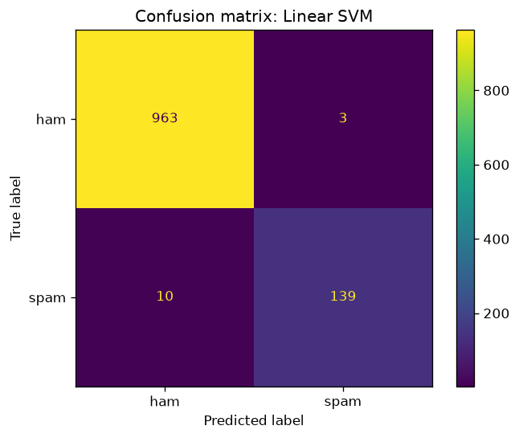

# SMS Spam Detector

A machine learning model that detects spam in SMS messages, served as a **Flask web app and REST API**.

## Problem
A mobile operator wants to automatically flag scam and advertising messages before they reach customers.

## Data
[SMS Spam Collection](https://archive.ics.uci.edu/dataset/228/sms+spam+collection) (UCI): 5572 English messages, 13.4% of which are spam. The classes are imbalanced, so models are evaluated with **F1 for the spam class** rather than accuracy alone.

## How it works
1. `train.py` downloads the data, splits it into a training and a test set (80/20), turns the text into **TF-IDF** features (words and word pairs) and compares three models with cross-validation.
2. The best model is evaluated on the test set and then saved to `model.joblib`.
3. `app.py` loads the model and serves a web page (`/`) and a `POST /api/predict` endpoint.
4. The page (`templates/index.html`, `static/`) checks messages live by calling the API with `fetch`, without reloading. It supports light and dark mode and works on phones. Without JavaScript it falls back to a regular form submit.

## Results
| Model | Spam F1 (5-fold CV) |
|---|---|
| Naive Bayes | 0.831 |
| Logistic Regression | 0.945 |
| **Linear SVM** | **0.955** |

Linear SVM on the test set: F1 = 0.955, precision = 0.98, recall = 0.93, accuracy = 98.8%.



## Tech stack
Python, pandas, scikit-learn, Flask, pytest, HTML, CSS, JavaScript

## How to run
```bash
python -m venv .venv
# Windows: .venv\Scripts\activate    macOS/Linux: source .venv/bin/activate
pip install -r requirements.txt
python train.py      # trains the model and saves model.joblib
python app.py        # open http://127.0.0.1:5000
python -m pytest     # tests
```

Example API request:
```bash
curl -X POST http://127.0.0.1:5000/api/predict -H "Content-Type: application/json" -d "{\"text\": \"You won a FREE prize! Call now\"}"
```
Response: `{"is_spam": true, "label": "spam", "text": "..."}`

## What I would add next
- a model for Polish messages
- a comparison with a BERT-style model
- cloud deployment (e.g. Render, Azure) and Docker
